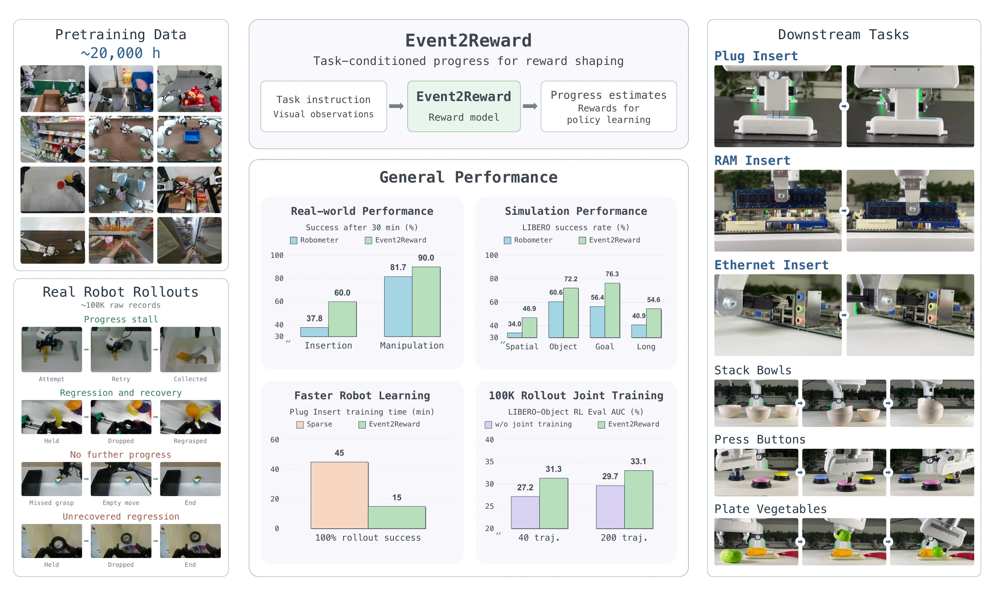
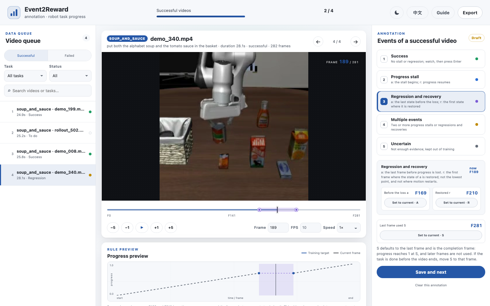

<div align="center">

# Event2Reward

**Learning Robotic Rewards from Progress Relations**

[](https://arxiv.org/abs/2610.39212)
[](https://niejunnan25.github.io/Event2Reward/)
[](https://huggingface.co/niejunnan25/Event2Reward-Qwen3.5-4B-Stage2)
[](LICENSE)




</div>

This repository contains the code and models of Event2Reward, a vision-language progress model for robot manipulation. Given a task description, the episode's start image, a goal image from an independent successful trajectory, and five recent frames, it estimates how far the task has progressed, as a number in [0, 1]; the change in this estimate gives a reinforcement-learning agent a dense reward. You can score your own episodes with the released models, annotate your own videos and fine-tune on them, and use the paper's fine-tuning configurations.

The method, results and interactive examples are on the [project page](https://niejunnan25.github.io/Event2Reward/).

Still being prepared, and released later:

- **Policy learning code**: the reinforcement-learning code of the paper's experiments.
- **Data**: the event-annotated rollout dataset curated from about 100K raw real-robot execution records.

## Installation

### Model environment: inference and training

Requires Linux x86_64 and an NVIDIA driver whose `nvidia-smi` reports CUDA Version ≥ 12.8. Inference needs no CUDA Toolkit.

```bash
git clone https://github.com/niejunnan25/Event2Reward.git
cd Event2Reward
conda create -n event2reward python=3.10 -y
conda activate event2reward
pip install -e .

# Recommended: the fast kernels used for the paper (prebuilt wheels)
pip install flash-linear-attention==0.5.2 fla-core==0.5.2
pip install https://github.com/Dao-AILab/causal-conv1d/releases/download/v1.7.0/causal_conv1d-1.7.0%2Bcu12torch2.8cxx11abiTRUE-cp310-cp310-linux_x86_64.whl
```

Without the fast kernels, inference falls back to slower PyTorch code with slightly different outputs. For training, use `pip install -e ".[train]"`. See [installation](docs/installation.md) for Hopper GPUs, exact versions and troubleshooting.

### Annotation tool

The annotation tool runs on any computer, with or without a GPU, on Linux, macOS or Windows. Usually you annotate on your own laptop and train on a GPU server:

```bash
# On your laptop: any Python 3.10 to 3.13
git clone https://github.com/niejunnan25/Event2Reward.git
cd Event2Reward
pip install -e ".[video]"
event2reward annotate add my_project --task stack_bowls --instruction "stack the bowls" \
  --success videos/success --failure videos/failure
event2reward annotate serve my_project          # annotate in the browser
event2reward annotate export my_project --output my_project/annotations.jsonl

# Copy the project folder, which holds the videos and the export, to the server, then convert and train there
rsync -a my_project/ server:Event2Reward/my_project/
```

See [annotation](docs/annotation.md) for the marks and [fine-tuning](#fine-tuning-on-your-own-robot) for the steps on the server.

## Quick start

```python
import json
from pathlib import Path
from event2reward import Event2Reward, Observation

model = Event2Reward.from_pretrained("niejunnan25/Event2Reward-Qwen3.5-4B-Stage2")

root = Path("examples/quickstart")
row = json.loads((root / "observations.json").read_text())[0]
observation = Observation(
    task=row["task"],                                    # "pick up the black bowl ... on the plate"
    start=root / row["start"],                           # first frame of the episode
    goal=root / row["goal"],                             # last frame of another successful episode
    history=[root / name for name in row["history"]],    # five recent frames, oldest first
)
print(model.predict([observation]))
```

```text
[{'progress': 0.3246, 'trend': 'growth', 'trend_probabilities': [0.9961, 0.0001, 0.0037],
  'progress_variance': 0.0227, 'progress_entropy': 4.0645}]
```

Output (rounded): `progress` is the estimate in [0, 1]; `trend` says whether progress grows, stays or falls within the five frames. The same query from the command line:

```bash
event2reward infer --bundle niejunnan25/Event2Reward-Qwen3.5-4B-Stage2 \
  --observations examples/quickstart/observations.json --output outputs/prediction.json
```

To score every frame of a video sampled at 10 Hz, each with its causal five-frame history:

```python
rows = model.predict_trajectory(frames=frames, task="put the banana into the cup", goal=goal_image)
```

One query takes about 0.09 s and 9 GiB of GPU memory (BF16, batch 1, H200). [Inference](docs/inference.md) covers inputs, batching, video timestamps and saving models.

## Models

| Model | Trained from | Use | Weights |
|---|---|---|---|
| Stage1 | Qwen3.5-4B, pretrained for 50,000 steps | Initialization of Stage2 | [🤗 Stage1](https://huggingface.co/niejunnan25/Event2Reward-Qwen3.5-4B-Stage1) |
| **Stage2** | Stage1 + rollout joint training, 10,000 steps | **General use; starting point for fine-tuning** | [🤗 Stage2](https://huggingface.co/niejunnan25/Event2Reward-Qwen3.5-4B-Stage2) |

All models share one architecture and one interface. A model name loads from the Hugging Face Hub; a local directory works the same way.

## Fine-tuning on your own robot

Annotate a few videos of your task, and fine-tune Stage2 on them. Successful and failed videos are annotated separately in a local web page: clean successes need only a keypress, and an imperfect video needs one or two marks, where it stalls or loses progress.



```bash
pip install -e ".[train]"
bash scripts/download_models.sh Stage2

# 1. Annotate: one task's successful and failed videos, in separate folders.
event2reward annotate add my_project --task stack_bowls --instruction "stack the bowls" \
  --success videos/success --failure videos/failure
event2reward annotate serve my_project
event2reward annotate export my_project --output my_project/annotations.jsonl

# 2. Convert, copy the example configuration (set output_dir and data.manifest in the copy), and train.
event2reward convert annotations --input my_project/annotations.jsonl --project my_project --output data/stack_bowls/dataset.json
cp examples/annotation/finetune.yaml configs/finetune/stack_bowls.yaml
event2reward train configs/finetune/stack_bowls.yaml --check
event2reward train configs/finetune/stack_bowls.yaml

# 3. Export the fine-tuned model and use it like Stage2.
event2reward export --checkpoint outputs/stack_bowls/checkpoint-000500 --output models/stack_bowls
```

Training uses your videos in two ways:

- **Absolute progress** from clean successful videos: elapsed time over completion time. Each task needs at least two.
- **Relations** from videos with the paper's four events (progress stall, regression and recovery, no further progress, unrecovered regression): how progress relates to the moment each event begins, with no absolute value. Any subset of the four works.

The example configuration, `examples/annotation/finetune.yaml`, gives each half of every microbatch; two optional counts add absolute targets for successful videos with progress stalls (`stall_success`) and for completion frames ([what a microbatch holds](docs/training.md#what-a-microbatch-holds)).

[`examples/annotation/`](examples/annotation) runs these steps on five annotated LIBERO videos, with a script that scores held-out videos before and after fine-tuning. [Annotation](docs/annotation.md) explains the labels and marks; [training](docs/training.md#a-new-environment) the configuration.

## The paper's fine-tuning configurations

The configurations of the paper's models; every fine-tuning starts from Stage2 (`bash scripts/download_models.sh Stage2`).

| Config | What it trains |
|---|---|
| [`configs/finetune/libero/`](configs/finetune/libero) | Stage2 → the four LIBERO reward models of the paper |
| [`configs/finetune/real_world_franka/`](configs/finetune/real_world_franka) | Stage2 → the reward models of the paper's six real-world tasks: `<task>_full.yaml` full fine-tuning, `<task>_lora.yaml` LoRA |

```bash
event2reward train configs/finetune/libero/goal.yaml --check      # validate config and data
event2reward train configs/finetune/libero/goal.yaml --gpus 2
```

Each config lists every setting of its run with comments, and runs on any data in the same format. A synthetic dataset exercises the complete pipeline without any download beyond Stage2. [Training](docs/training.md) explains the configuration, checkpoints, resuming, export and adding an environment; [data](docs/data.md) defines the data formats.

## Repository structure

```text
Event2Reward/
├── configs/            fine-tuning configurations (LIBERO, Franka)
├── scripts/            model download
├── src/event2reward/
│   ├── inference.py    Event2Reward and Observation: load a model, score observations
│   ├── bundle.py       model directory format, as on the Hugging Face Hub
│   ├── modeling/       model, heads and losses
│   ├── data/           data formats, datasets, sampler; converters/ writes dataset manifests
│   ├── train/          trainer, configuration, LoRA, optimizer, checkpoints
│   ├── annotation/     the annotation tool: projects, checks, local web page
│   └── cli.py          the event2reward command: infer, annotate, convert, train, export, env
├── examples/           quick-start query, and annotated videos for fine-tuning
├── docs/               installation, inference, annotation, data, training
└── tests/              tests of the model, data, annotation tool, trainer and configurations
```

Downloads and results go to `models/`, `data/` and `outputs/`, which Git ignores.

| Guide | Contents |
|---|---|
| [Installation](docs/installation.md) | Requirements, fast kernels, Hopper training setup, reference environment, troubleshooting |
| [Inference](docs/inference.md) | Observations, outputs, trajectories and video, command line, saving |
| [Annotation](docs/annotation.md) | Annotating successful and failed videos, keys, the export |
| [Data](docs/data.md) | Trajectory and index formats, converting annotation exports, LIBERO index files, licenses |
| [Training](docs/training.md) | Configuration reference, checkpoints and export, LIBERO, Franka, new environments |

## Usage notes

- The goal image must come from an **independent successful trajectory** of the same task, never from the episode being scored.
- Progress is not a success probability. It can decrease, and no threshold separates success from failure.
- Feed frames from the same external camera at 10 Hz; history frames must never come from the future.
- `trend` is an auxiliary output, not a validated event detector.

## Fine-tuning tips

The provided configurations work as they are. Depending on your task and data, these adjustments can make the progress curve fit better; none of them is required.

- **Completion frames.** If predictions near the end of successful episodes stay below 1, set `data.trajectories.sampling.progress.completion: 1`, taking one place from `expert` so the counts still sum to `training.batch_size`. Every microbatch then also holds a completion frame with progress 1, which anchors the end of the curve.
- **History length.** If a step of your task leaves little visible trace once it is done, such as pressing a button, the default 0.4 s history may not show it. Longer offsets, for example `data.trajectories.history_offsets: [8, 4, 2, 0.5, 0]`, let the model see earlier steps; choose the span from how long a step of your task takes.
- **Successful videos with stalls.** If you have few clean successful videos but several successful ones with progress stalls, set `progress.stall_success: 1` so that those videos also give absolute progress, with the stall time left out.

## Citation

```bibtex
@misc{nie2026event2reward,
  title         = {Event2Reward: Learning Robotic Rewards from Progress Relations},
  author        = {Nie, Junnan and Fan, Zitian and Zhang, Jiachen and Lao, Junyi and Zhang, Likui and Liu, Chenghao and Lu, Xiaoyang and Wang, Yunbo and Zhang, Yixue and Zhai, Linbo and Li, Jiayi and Wang, Mengzhe and Wu, Xichang and Wang, Bin and Liu, Chang and Zhang, Tianle and Huang, Songfang},
  year          = {2026},
  eprint        = {2610.39212},
  archivePrefix = {arXiv},
  primaryClass  = {cs.RO},
  url           = {https://arxiv.org/abs/2610.39212}
}
```

## License

Code and model weights are released under [Apache-2.0](LICENSE); attribution to Qwen3.5 is in [NOTICE](NOTICE). Third-party images and annotations keep their own terms; see [data](docs/data.md#licenses).

## Acknowledgements

Event2Reward builds on [Qwen3.5](https://huggingface.co/Qwen/Qwen3.5-4B), [LIBERO](https://github.com/Lifelong-Robot-Learning/LIBERO), [flash-linear-attention](https://github.com/fla-org/flash-linear-attention) and [causal-conv1d](https://github.com/Dao-AILab/causal-conv1d).
