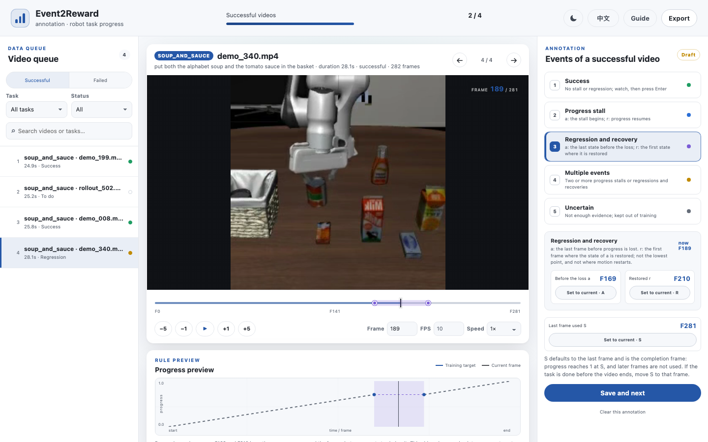

# Annotation

The annotation tool turns your own videos into a fine-tuning dataset. You mark the paper's four events: where a successful execution stalls or regresses and recovers, and where a failed one stops progressing or regresses for good; the trainer turns these marks into the supervision used in the paper ([event types](data.md#trajectory-data)). It runs locally in the browser and needs PyAV to read the videos (`pip install -e ".[video]"`, included in `.[train]`).

- [The workflow](#the-workflow)
- [Successful videos](#successful-videos)
- [Failed videos](#failed-videos)
- [Keys](#keys)
- [The export](#the-export)
- [How many videos](#how-many-videos)

## The workflow

```bash
# 1. Put one task's videos in a project: successful and failed videos in separate folders.
event2reward annotate add my_project --task stack_bowls --instruction "stack the bowls" \
  --success videos/stack_bowls/success --failure videos/stack_bowls/failure
event2reward annotate add my_project --task stack_bowls --instruction "stack the bowls" \
  --success videos/stack_bowls/held_out --split test

# 2. Annotate in the browser (http://127.0.0.1:8765).
event2reward annotate serve my_project

# 3. Export, convert, train.
event2reward annotate export my_project --output annotations.jsonl
event2reward convert annotations --input annotations.jsonl --project my_project --output data/stack_bowls/dataset.json
cp examples/annotation/finetune.yaml configs/finetune/stack_bowls.yaml   # set output_dir and data.manifest
event2reward train configs/finetune/stack_bowls.yaml
```

`annotate add` copies the videos into `my_project/media/` and reads the timestamp of every frame, so any frame rate works. Run it once per task and folder; a video already in the project is skipped. `--split test` keeps held-out videos out of training. If seeking in the browser is slow, add `--reencode`, which stores H.264 copies with a keyframe every second. [`examples/annotation/finetune.yaml`](../examples/annotation/finetune.yaml) is an example fine-tuning configuration ([new environment](training.md#a-new-environment)).

Saved annotations go to `my_project/annotations.json`; unsaved changes are kept as drafts in the browser. The page opens in English and in light mode; the buttons at the top right switch to Chinese and to dark mode, and the choice is remembered.

## Successful videos



Successful and failed videos are annotated separately; switch with the two buttons at the top of the queue. Within a task, videos are listed from shortest to longest, so you see compact executions first and then judge the longer ones against them.

The events are the paper's four. Each is marked with one or two points: **a**, where the event begins, and, for the events a video recovers from, **r**, where it ends.

| Event | Points | Meaning |
|---|---|---|
| Success | none | The task progresses without a stall or regression. Selected by default; watch and press Enter. |
| Progress stall | **a** the stall begins, **r** progress resumes | Nothing is gained between a and r. |
| Regression and recovery | **a** the last state before the loss, **r** the first state where it is restored | Progress is lost after a and restored at r. |
| Multiple events | a and r for each event | Two or more progress stalls or regressions and recoveries, in time order. |
| Uncertain | none | Kept out of training. |

To mark an event, move to where it begins and click it: the current frame becomes **a**. Then move to its end and press **R**. For a regression and recovery, r is where the state of a is restored, not the lowest point and not where the robot starts moving again. A video is annotated only once it is saved; the default alone does not count.

**S** is the last frame used for training and, in a successful video, the completion frame: progress reaches 1 at S. It defaults to the last frame. If the task is done before the video ends, move S to the frame where it is done; the frames after it are not used.

The curve under the video previews what training learns from your points: progress grows with time and stays level during a progress stall; inside a regression it is only required to stay below a and r. It is not a hand-drawn progress label.

## Failed videos

| Event | Points | Meaning |
|---|---|---|
| No further progress | **a** the last state with real progress | Nothing is gained after a until S. |
| Unrecovered regression | **a** the last state before the loss; **l** (optional) where the loss is visible | Progress falls below a and is not restored until S. |
| Uncertain | none | Kept out of training. |

Move to a and click the event: the current frame becomes **a**. For an unrecovered regression, l marks where the loss becomes visible; without it, training uses the frames from 0.5 s after a. S works as for successful videos. Judge only what the recording shows, not whether the robot could still have recovered after it ended.

## Keys

| Key | Action |
|---|---|
| 1 – 5 | Choose an event; the current frame becomes its a |
| A R L S | Set that point to the current frame |
| Space | Play or pause |
| ← → | One frame; with Shift, five frames |
| J K | Previous or next video |
| Enter | Save and go to the next video |

## The export

`event2reward annotate export` writes one JSON line per saved video (`event2reward.annotation.v1`):

```json
{"schema": "event2reward.annotation.v1", "uid": "soup_and_sauce/success/demo_340",
 "task": "soup_and_sauce", "instruction": "put both the alphabet soup and the tomato sauce in the basket",
 "mode": "success", "split": "train", "video": "media/soup_and_sauce/success/demo_340.mp4",
 "times": [0.0, 0.1, 0.2, "..."], "label": "regression_and_recovery",
 "events": [{"type": "regression_and_recovery", "a_frame": 169, "r_frame": 210}],
 "final_frame": 281, "saved_at": "2026-11-01T09:52:16+00:00"}
```

| Field | Meaning |
|---|---|
| `uid` | `task/mode/file name`; unique in the project |
| `mode` | `success` or `failure`: the tab the video was annotated in |
| `video`, `times` | The video, relative to the project folder, and the timestamp of every frame in seconds |
| `label` | `success`, `progress_stall`, `regression_and_recovery`, `multiple_events` or `uncertain` for a successful video; `no_further_progress`, `unrecovered_regression` or `uncertain` for a failed one |
| `events` | The events, each with its `type` (the event names above) and `a_frame`; `progress_stall` and `regression_and_recovery` also have `r_frame`, `unrecovered_regression` an optional `loss_frame` (l) |
| `final_frame` | S: the last frame used, and the completion frame of a successful video |

`event2reward convert annotations` turns each row into one trajectory: successes become the demonstrations that give absolute progress, the other videos event trajectories, and uncertain videos are left out. The events keep their points and take the event types of the [trajectory format](data.md#trajectory-data).

## How many videos

The paper's Franka reward models were fine-tuned on 10 videos per task: 5 successful and 5 suboptimal trajectories. Each task needs at least two clean successful videos, which also provide the goal images. Annotate the failures and imperfect successes your policy actually produces: these are what the relations learn from, and any subset of the event types works. In the paper, annotating the five suboptimal trajectories of a task took about a minute.
